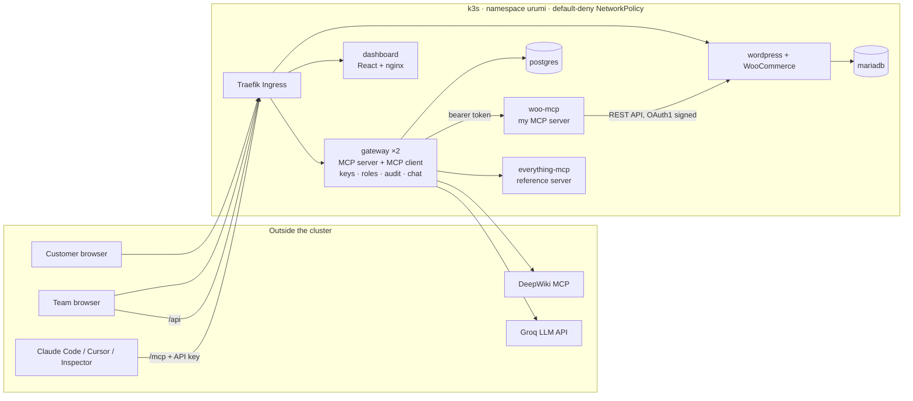

# Urumi: WooCommerce hosting with a team MCP gateway

This is my submission for the Urumi AI FDE internship, round 1.

It runs a WooCommerce store on Kubernetes, plus an MCP server I wrote for it, a gateway that puts several MCP servers behind one endpoint for the whole team, and a chat agent in the dashboard. Everything is installed by one Helm chart. Locally it runs on k3d; on a VPS it runs on k3s with the same chart and a different values file.



The system has four layers:

1. **Store:** WordPress + WooCommerce + MariaDB. Both use persistent volumes, and a Helm hook Job sets the store up automatically (installs WordPress and WooCommerce, enables cash on delivery, sets permalinks, creates the REST API key).
2. **WooCommerce MCP server** (`services/woo-mcp`): written from scratch in TypeScript, speaks MCP over Streamable HTTP, and exposes `list_products`, `create_product`, `list_orders`, `get_order` and `update_order_status`. It's internal only.
3. **Gateway + dashboard** (`services/gateway`, `services/dashboard`): admins register MCP servers once. The gateway is an MCP client to every server and an MCP server itself, on one endpoint. It also handles users, API keys, roles and the audit log.
4. **Chat agent** (inside the gateway): an LLM tool loop that calls the same tools through the gateway, as the logged-in user.

More detail is in **[docs/design.md](docs/design.md)** (system design and tradeoffs) and **[docs/threat-model.md](docs/threat-model.md)**.

## Repo layout

| Path | What it is |
|---|---|
| `charts/urumi/` | Umbrella Helm chart: `values.yaml`, `values-local.yaml`, `values-prod.yaml` |
| `charts/urumi/charts/store/` | WordPress, MariaDB, setup Job, Ingress, NetworkPolicies |
| `charts/urumi/charts/woo-mcp/` | My WooCommerce MCP server |
| `charts/urumi/charts/everything-mcp/` | The MCP reference server, as a second in-cluster upstream |
| `charts/urumi/charts/gateway/` | Gateway, Postgres, dashboard, their Ingresses and NetworkPolicies |
| `services/woo-mcp/` | WooCommerce MCP server (TypeScript) |
| `services/gateway/` | Gateway: MCP endpoint, upstream manager, REST API for the dashboard, chat agent (TypeScript) |
| `services/dashboard/` | Dashboard (React + Vite, served by nginx) |
| `services/everything/` | Dockerfile that packages the official `server-everything` |
| `scripts/cluster-up.sh`, `Makefile` | Local cluster and everyday commands |

## Running it locally (k3d)

**You need:** Docker (give it at least 6 GB of memory), [k3d](https://k3d.io), kubectl and Helm 3.8+. Node is not needed on the host, because the images are built inside Docker.

```sh
make cluster      # k3d cluster "urumi": one node, laptop ports 80/443 → Traefik
make images       # build the 4 images and load them into k3d (no registry needed)
make llm-key      # paste an LLM API key for the chat agent (input is hidden); optional, see below
make deploy       # helm upgrade --install with values-local.yaml (first run takes 3-5 min)
make status       # everything should be Running, and the store-setup Job Completed
```

Every `make` target passes `--context k3d-urumi` explicitly, so nothing goes to another cluster by accident.

**URLs and logins**

| What | URL | Login |
|---|---|---|
| Storefront | http://store.localtest.me | none |
| WooCommerce admin | http://store.localtest.me/wp-admin | `admin` / `make admin-password` |
| Dashboard | http://dashboard.localtest.me | `admin@urumi.local` / `make gateway-admin-password` |
| MCP endpoint | http://gateway.localtest.me/mcp | `Authorization: Bearer <your API key>` |

**Local domains:** I use `*.localtest.me`, a public DNS name where every subdomain resolves to `127.0.0.1`. k3d maps the laptop's port 80 to Traefik, and Traefik routes by hostname. There's nothing to add to `/etc/hosts`, and it works the same on any machine (it needs internet for the DNS lookup).

**Passwords** are generated by Helm on the first install and stored in Kubernetes Secrets. Helm reads them back on every upgrade (`lookup`), so they never change underneath MariaDB or Postgres. Nothing secret is in the repo.

**The chat agent's key:** the chat uses an OpenAI-compatible API, Groq's free tier by default (`openai/gpt-oss-120b`). `make llm-key` stores the key in the `urumi-llm` Secret. Without it everything else works and the chat page just says it's switched off. If you add the key after deploying, run `kubectl --context k3d-urumi -n urumi rollout restart deploy/urumi-gateway`. To use Gemini, OpenRouter, OpenAI or a local Ollama instead, change `gateway.llm` in the values file.

## Using it

### Place an order

1. Open http://store.localtest.me and open a product (the setup Job creates "Urumi T-Shirt").
2. **Add to cart**, then go to **Checkout**.
3. Fill in the billing details, choose **Cash on delivery** and click **Place Order**.
4. The order appears under **WP Admin → WooCommerce → Orders**.

### Admin: servers, members and keys

Log in to the dashboard as `admin@urumi.local`.

- **servers:** the three registered upstreams (`woocommerce` first, then `everything` and `deepwiki`) with live status (`▲ up`, `▼ down` with the reason, `■ off`) and their tools. Admins can add a server by URL with an optional bearer token or custom header, and edit, disable, re-check or remove one. Credentials are write-only: once saved they're never shown again.
- **members:** invite someone by email as `member` or `admin`. You get a one-time invite link (valid 7 days) to send them. You can change roles or remove people here.
- **api keys:** tick "show everyone's keys" to see and revoke any member's keys.
- **audit:** every tool call: who, from where (`mcp` or `chat`), server, tool, time, duration and outcome. It has filters and refreshes live.

### Connect an external MCP client

1. Log in to the dashboard (as yourself) and go to **api keys** → **generate key**. The key is shown once, together with ready-to-paste configs.
2. Add the gateway to your client. That's all the client needs: one URL and your key.

**Claude Code**
```sh
claude mcp add --transport http urumi http://gateway.localtest.me/mcp --header "Authorization: Bearer mgw_..."
```

**Cursor** (`~/.cursor/mcp.json`)
```json
{ "mcpServers": { "urumi": { "url": "http://gateway.localtest.me/mcp", "headers": { "Authorization": "Bearer mgw_..." } } } }
```

**MCP Inspector:** run `npx @modelcontextprotocol/inspector`, choose **Streamable HTTP** with URL `http://gateway.localtest.me/mcp`, then under **Authentication** add the header `Authorization` = `Bearer mgw_...` and switch it on. Click **Connect**, then **Tools → List Tools**.

Tools are named `<server>__<tool>`, for example `woocommerce__list_orders`, `everything__get-sum` or `deepwiki__ask_wiki_question`. You never see or need the upstream servers' credentials.

Two prompts to try: *"What orders came in today?"*, and one that needs two servers: *"Get today's orders from the store, then add up the totals of the two most recent ones with the get-sum tool."*

### Chat agent

Open **chat** in the dashboard and ask something, for example:

- *Create a product called "Masala Chai Tin" priced at 249.* → it appears on the storefront right away
- *What orders came in today?*
- *Mark order 23 as completed.*

Each tool the agent called is shown above its answer as a line you can expand, with the arguments and result. The agent acts as you: its calls go through the same gateway code as external clients and appear in the audit log under your name with source `chat`.

## Deploying on a VPS (k3s)

The same chart is used. Only `values-prod.yaml` differs (hostnames, TLS, images, storage sizes).

1. **Install k3s** (it includes Traefik and the `local-path` storage class):
   ```sh
   curl -sfL https://get.k3s.io | sh -
   export KUBECONFIG=/etc/rancher/k3s/k3s.yaml
   ```
2. **DNS:** point `store.<domain>`, `dashboard.<domain>` and `gateway.<domain>` at the VPS IP. No domain? `<ip>.nip.io` names work, e.g. `store.203.0.113.10.nip.io`.
3. **cert-manager + a Let's Encrypt issuer:**
   ```sh
   helm install cert-manager oci://quay.io/jetstack/charts/cert-manager -n cert-manager --create-namespace --set crds.enabled=true
   kubectl apply -f - <<'EOF'
   apiVersion: cert-manager.io/v1
   kind: ClusterIssuer
   metadata: { name: letsencrypt }
   spec:
     acme:
       email: you@example.com
       server: https://acme-v02.api.letsencrypt.org/directory
       privateKeySecretRef: { name: letsencrypt-account }
       solvers:
         - http01: { ingress: { ingressClassName: traefik } }
   EOF
   ```
4. **Images:** either push them to a registry the VPS can pull from (`make push REGISTRY=ghcr.io/<you>`, then make the packages public), or build them on the VPS and import them straight into k3s:
   ```sh
   docker build -t urumi/gateway:0.4.2 services/gateway && docker save urumi/gateway:0.4.2 | sudo k3s ctr images import -
   ```
   If you import images this way, keep the `urumi/...` names in the values file.
5. **Edit `charts/urumi/values-prod.yaml`:** set the three hostnames (replace `example.com`) and the image repositories.
6. **LLM key and install:**
   ```sh
   kubectl create namespace urumi
   kubectl -n urumi create secret generic urumi-llm --from-literal=api-key=<key>
   helm upgrade --install urumi charts/urumi -n urumi -f charts/urumi/values-prod.yaml --timeout 15m
   ```

What changes between local and prod, and why, is in [docs/design.md](docs/design.md#what-changes-for-production).

## Upgrades and rollback

```sh
helm upgrade urumi charts/urumi -n urumi -f charts/urumi/values-local.yaml   # e.g. after bumping an image tag
helm history urumi -n urumi                                                  # every upgrade is a numbered revision
helm rollback urumi <revision> -n urumi                                      # back to exactly what ran before
```

- **Image tags are pinned** (no `latest`), so a revision always means the same images.
- **Gateway, woo-mcp and dashboard roll over** with a 5-second `preStop` pause, so requests don't hit a Pod that's shutting down.
- **WordPress uses `Recreate`**, because its files volume is ReadWriteOnce.
- **The store setup Job runs again** after every install and upgrade. Each step checks before acting, so running it again is harmless.
- **Secrets and PVCs carry `helm.sh/resource-policy: keep`**, and their values are reused, so neither upgrades nor rollbacks touch data or passwords.
- **Upgrading WooCommerce or WordPress** means bumping `store.setup.wooVersion` or `store.wordpress.image` and running `helm upgrade`.

## How woo-mcp talks to the store

It uses the **WooCommerce REST API (v3)**. I chose it over direct database access and WP-CLI because:

- **It goes through WooCommerce's own logic:** stock, totals, order notes, emails and hooks all happen as if a person did it in the admin.
- **It stays stable across WooCommerce versions.** Orders, for example, moved to new database tables (HPOS); the API hides that.
- **It needs only a limited, revocable API key**, not the database password.

Inside the cluster the call is plain HTTP to `http://urumi-wordpress`, so WooCommerce requires OAuth 1.0a signing: each request carries an HMAC signature made with the secret, and the secret itself never goes over the network. The key pair is generated by Helm into its own Secret, `urumi-woo-api`, and registered in WooCommerce by the setup Job.

## Stand-out items I attempted

| Item | What I did | Where |
|---|---|---|
| **6. Security hardening** | SSRF protection on upstream URLs (private, cluster-internal and metadata addresses refused, checked when saved and on every connect); default-deny NetworkPolicies with per-component allow rules; every container non-root except WordPress; upstream credentials encrypted at rest (AES-256-GCM). No component talks to the Kubernetes API, so none gets a service-account token. | `services/gateway/src/ssrf.ts`, `security.ts`, `charts/**/networkpolicy*.yaml` |
| **7. Scaling** | Two gateway replicas. The MCP endpoint is stateless, so any replica answers any request, and server changes reach all replicas instantly through Postgres `LISTEN/NOTIFY`. No per-user rate limits yet. | `services/gateway/src/mcp.ts`, `db.ts` |
| **9. Upgrades and rollback** | Pinned images, `preStop` drains, an idempotent setup Job, Secrets and PVCs kept, documented above. | this README, `charts/` |
| **1. VPS deployment** | `values-prod.yaml` and the steps above, with cert-manager TLS. The rendered manifests are checked with `helm template`, but I haven't run it on a live VPS yet. | `charts/urumi/values-prod.yaml` |
| **8. Observability** (partly) | The dashboard shows *why* an upstream is down ("connection refused", "no answer before the timeout"…), and the audit log records duration and error per call. No metrics endpoint. | dashboard **servers** and **audit** |

I didn't attempt the multi-store bonus.

## Known limitations

- **WordPress runs as root.** The official Apache image needs root to bind port 80 and runs PHP as `www-data`. Everything else is non-root.
- **The free LLM tier allows about 8k tokens per minute.** The agent waits and retries when it's rate-limited, so back-to-back questions can take a few seconds longer.
- **One MariaDB and one Postgres replica, with no backups configured.** They're fine for a demo; production would need backups or a managed database.
- **API keys and dashboard logins only.** I didn't do OAuth for MCP clients.
