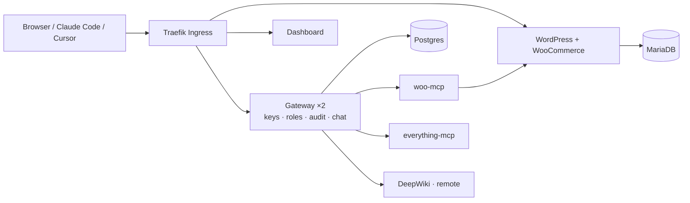

# Urumi: WooCommerce hosting with a team MCP gateway

A WooCommerce store on Kubernetes, an MCP server I wrote for it, a gateway that puts several MCP servers behind **one endpoint** for the whole team, and a chat agent that uses the same tools. One Helm chart: k3d locally, k3s on a VPS.



- **Design and tradeoffs:** [docs/design.md](docs/design.md)
- **Threat model:** [docs/threat-model.md](docs/threat-model.md)

## Quick start (local)

**Requirements:** Docker (with 6 GB+ memory), [k3d](https://k3d.io), kubectl and Helm.

```sh
make cluster   # create the k3d cluster
make images    # build the images and load them into k3d
make llm-key   # paste an API key for the chat agent (Groq free tier); skip it to run without chat
make deploy    # install everything (the first run takes 3–5 minutes)
make status    # all Pods should be Running
```

| Open | URL | Login |
|---|---|---|
| Storefront | http://store.localtest.me | none |
| WooCommerce admin | http://store.localtest.me/wp-admin | `admin` / `make admin-password` |
| Dashboard | http://dashboard.localtest.me | `admin@urumi.local` / `make gateway-admin-password` |
| MCP endpoint | http://gateway.localtest.me/mcp | your API key |

`*.localtest.me` always resolves to `127.0.0.1`, and k3d forwards port 80 to Traefik, so there's nothing to add to `/etc/hosts`. All passwords are generated on the first install and stored in Kubernetes Secrets.

## Using it

### Place an order
1. On the storefront, open a product → **Add to cart** → **Checkout**.
2. Fill in the details, choose **Cash on delivery** and click **Place Order**.
3. The order appears in **WP Admin → WooCommerce → Orders**.

### Manage the team (admin)
In the dashboard:
- **servers:** add, edit, disable or remove MCP servers, and see their status and tools.
- **members:** invite people and get a one-time invite link.
- **api keys:** tick "show everyone's keys" to revoke any member's key.
- **audit:** see every tool call.

### Connect an external MCP client
1. In the dashboard, go to **api keys** → **generate key**. The key is shown only once.
2. Add the gateway to your client:

```sh
# Claude Code
claude mcp add --transport http urumi http://gateway.localtest.me/mcp --header "Authorization: Bearer <key>"
```
```json
// Cursor: ~/.cursor/mcp.json
{ "mcpServers": { "urumi": { "url": "http://gateway.localtest.me/mcp", "headers": { "Authorization": "Bearer <key>" } } } }
```
**MCP Inspector:** run `npx @modelcontextprotocol/inspector`, choose **Streamable HTTP**, enter the URL above, add the header `Authorization: Bearer <key>` under **Authentication** and switch it on, then **Connect**.

Tools are named `<server>__<tool>`, for example `woocommerce__list_orders`. Try *"What orders came in today?"*

### Chat agent
Open **chat** in the dashboard and ask, for example: *"Create a product called Masala Chai Tin priced at 249"* or *"What orders came in today?"* Every tool the agent calls is shown above its answer and logged in the audit log under your name.

## Deploy on a VPS (k3s)

Same chart; only [`values-prod.yaml`](charts/urumi/values-prod.yaml) changes (hostnames, TLS, images, storage sizes).

1. **Install k3s** (it includes Traefik and local-path storage):
   ```sh
   curl -sfL https://get.k3s.io | sh -
   export KUBECONFIG=/etc/rancher/k3s/k3s.yaml
   ```
2. **DNS:** point `store.`, `dashboard.` and `gateway.<your-domain>` at the VPS. No domain? `store.<ip>.nip.io` works too.
3. **TLS:** install cert-manager and create a ClusterIssuer named `letsencrypt`:
   ```sh
   helm install cert-manager oci://quay.io/jetstack/charts/cert-manager -n cert-manager --create-namespace --set crds.enabled=true
   kubectl apply -f - <<'EOF'
   apiVersion: cert-manager.io/v1
   kind: ClusterIssuer
   metadata: { name: letsencrypt }
   spec:
     acme:
       email: you@example.com
       server: https://acme-v02.api.letsencrypt.org/directory
       privateKeySecretRef: { name: letsencrypt-account }
       solvers: [{ http01: { ingress: { ingressClassName: traefik } } }]
   EOF
   ```
4. **Images:** run `make push REGISTRY=ghcr.io/<you>` and make the packages public. Then set the hostnames and image repositories in `values-prod.yaml`.
5. **Install:**
   ```sh
   kubectl create namespace urumi
   kubectl -n urumi create secret generic urumi-llm --from-literal=api-key=<key>
   helm upgrade --install urumi charts/urumi -n urumi -f charts/urumi/values-prod.yaml --timeout 15m
   ```

## Upgrade and rollback

```sh
make deploy                       # upgrade after changing code (bump the image tag) or values
helm -n urumi history urumi       # every upgrade is a numbered revision
helm -n urumi rollback urumi <n>  # go back to exactly what ran before
```

- **Image tags are pinned**, so a revision always means the same images.
- **Passwords and volumes are kept** across upgrades and rollbacks.
- **The store setup Job is safe to run again** on every upgrade.

## Notes

- **How woo-mcp talks to the store:** through the WooCommerce REST API, with OAuth 1.0a request signing. This goes through WooCommerce's own logic, stays stable across versions, and uses a limited, revocable key instead of the database password. [More in the design note](docs/design.md#architecture-choices).
- **Stand-out items attempted:**
  - **Security hardening:** SSRF guard, default-deny NetworkPolicies, non-root containers, encrypted upstream credentials.
  - **Scaling:** 2 stateless gateway replicas.
  - **Upgrades and rollback:** as above.
  - **VPS values with cert-manager TLS:** prepared, not yet tested on a live server.
- **Known limitations:**
  - WordPress runs as root (the official Apache image).
  - No per-role tool permissions or per-user rate limits yet.
  - The free LLM tier is rate-limited, so the chat can be slow when used back to back.
